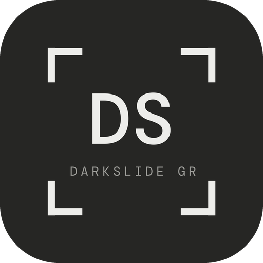
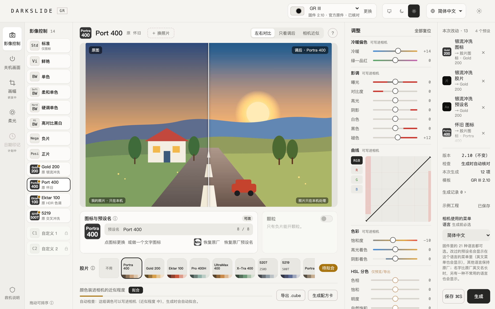
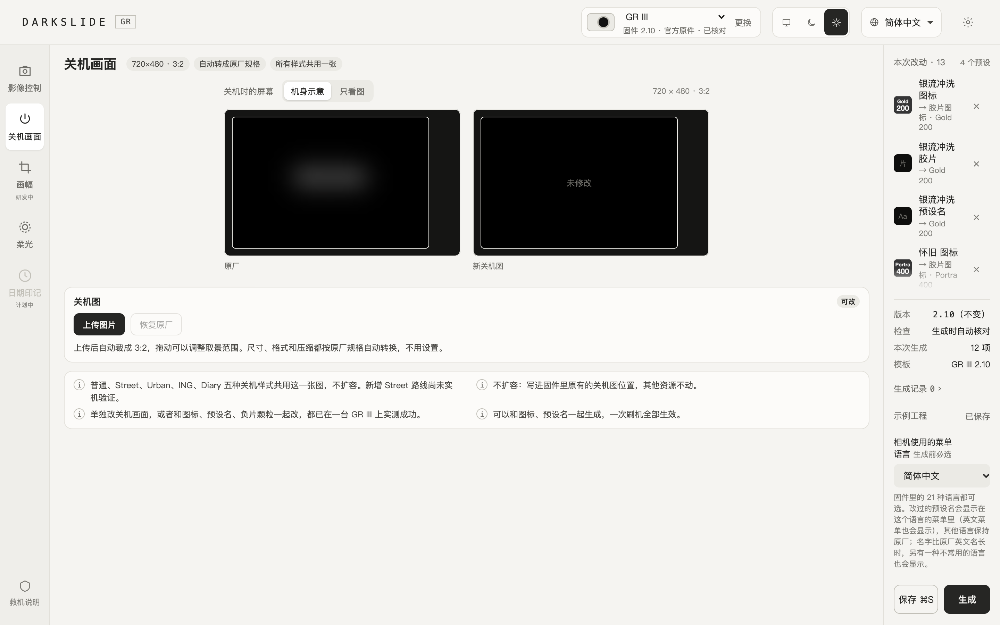
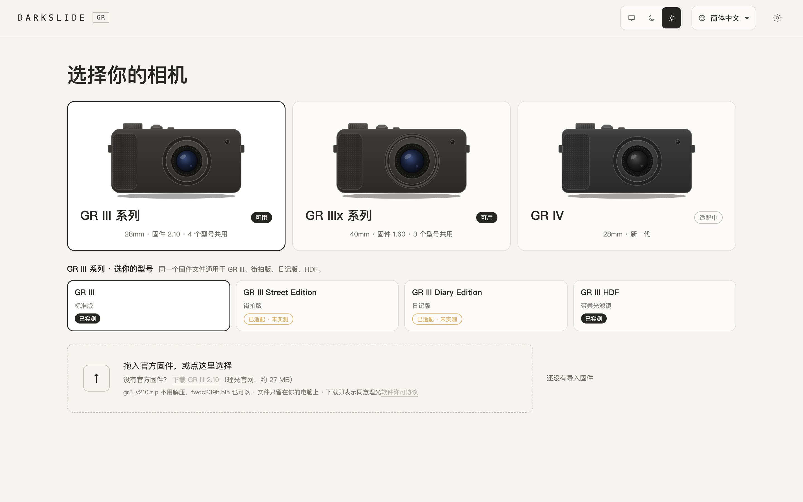
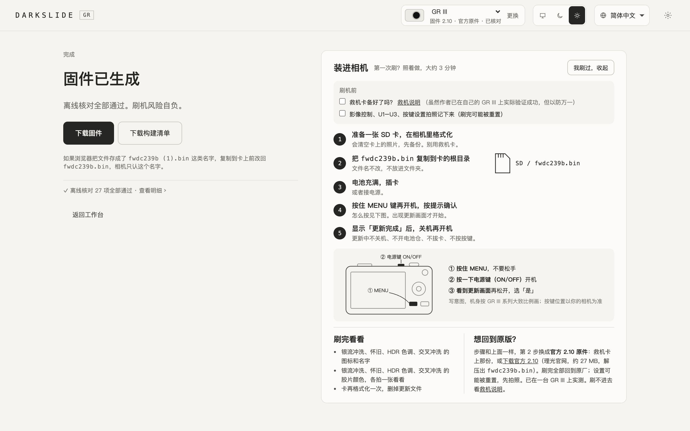

<p align="center"></p>

# DARKSLIDE GR

[简体中文](README.md) | English

Give four presets on your GR III / GR IIIx a film look each, or **your own LUT**; add your own preset icons, preset names and shutdown screen, and turn on grain for Negative Film, right from a browser on your own computer.



> [!WARNING]
> **Flashing modified firmware is risky. Please read this first.**
>
> - Your camera may fail to boot, stop working properly, or be **permanently bricked**. You may also lose warranty and official support.
> - The author has flashed and tested it on **one** GR III (firmware 2.10): icons and preset names for all 12 open presets (including names lengthened to the limit), the shutdown screen, Negative Film grain, several changes together, and flashing the official 2.10 original back afterwards, with no problems found. That is a sample of one camera, and your own icons, preset names and pictures have never been on real hardware; all pre-build checks run offline and are no substitute for testing on hardware.
> - The 1.0 film writing was also tested once with four films on one regular GR III; the author found no problems, but the item-by-item record is not finished, and your film combination may never have been tested. The GR III HDF was tested on one camera by user @Ady0402 (generating, flashing, films, preset names and the Traditional Chinese menu all worked, and film presets are no longer over-exposed). The standard GR IIIx was flashed and used normally on one camera by a user. The GR III Street and Diary editions and the GR IIIx Urban and HDF editions have **not been tested on real hardware**; you confirm the risk before generating.
> - This project is not affiliated with or endorsed by RICOH. The author accepts no liability for any damage.
> - What DARKSLIDE GR produces is a firmware file, nothing more: it **does not talk to your camera or touch your memory card**. Flashing it, and how, is your call.
>
> If it breaks, you get to keep both pieces. If you can't live with a very stylish brick, don't flash it.

## No RICOH firmware included

This repository does **not** contain any RICOH firmware, stock or modified, and does not offer any for download. Bring your own official file and make sure you are entitled to use it.

Regular generation uses the GR III input below. The IIIx offline workflow uses the separate 1.60 identity listed next; imports check model, size and SHA-256:

| Item | Value |
|---|---|
| Model / version | GR III · firmware 2.10 |
| File name | `fwdc239b.bin` |
| Size | 30,391,780 bytes |
| SHA-256 | `d6a3c9c288d784080e7b283222ecdd8752adfeed6faa36dab44f73115354bfd4` |

Check it yourself: `shasum -a 256 fwdc239b.bin` (Windows: `certutil -hashfile fwdc239b.bin SHA256`)

## GR IIIx 1.60

Input: `fwdc243b.bin`, 30,391,788 bytes, SHA-256 `708e79f3b7b96a7e1581b4acf4c412233050a1832718ef7f06c8397db1b431c7`. The firmware is the same for the standard and HDF bodies, so pick the right model when you create a project.

- **What works**: the 16 films, fitting your own LUTs and grades, camera-model previews, offline checks, and building complete firmware (in-place replacement, no growth).
- **Tested so far**: the standard GR IIIx was flashed and used normally on one camera by a user and is marked "tested"; the Urban and HDF editions are still "adapted, not camera-tested", and each build for them asks you to confirm the risk. Flashing the official 1.60 back has not been tested on a camera. The other hardware test results below apply only to GR III 2.10.
- **1.0 does not offer the photo-recipe module** (saving or reading film recipes in photos): it would append code and grow the firmware, so the option is hidden and the API refuses it.
- **No developer tools needed**: building uses bundled, precompiled ARM code fragments, so Mac and Windows users need no Xcode, Command Line Tools or clang. Missing or damaged fragments stop the build; download the complete program again. Only developers rebuilding the fragments need LLVM clang with `armv7a-none-eabi`. Full firmware building has not been validated on a real Windows machine.
- **Old IIIx projects**: the project list can import an old IIIx data folder: review the list, then copy it in; the old folder is kept, and old user LUTs need to be fitted again.

## What it does

Give the presets in your GR III menu **your own icons and names**. For example, rename "Positive Film" to "Summer" and give it a small icon you designed yourself; that is how it will appear in the camera menu.

**Presets you can change right now**

| Preset | Icon | Name |
|---|---|---|
| Vivid, Monotone, HDR Tone | ✅ | ✅ (up to 12 characters) |
| Retro | ✅ | ✅ (up to 8 characters) |
| Soft Monotone, Hard Monotone, Hi-Contrast B&W, Positive Film, Bleach Bypass, Cross Processing, Negative Film | ✅ | ✅ (factory length) |
| Standard | ✅ | — |
| Custom 1/2 | — | — |

- **Two ways to make an icon**: upload any image and frame it with the crop box, or type a few letters to generate a text icon in the factory style.
- **Preset names**: checked as you type, e.g. characters the camera can't display; typing stops at the length limit. The English menu and the camera menu language you pick above Generate (any of the firmware's 21 languages; new projects preselect your computer's language, so check it matches the camera) show the new name, other languages keep the factory name (Traditional Chinese was confirmed on a GR III HDF; the other added languages are untested on a camera); when a name is longer than the factory English name, one less common menu language also shows the new name.
- **What it never touches**: apart from the films you install and Negative Film grain, colour rendering, image-quality parameters and all other settings stay as they are. The firmware version number does not change (GR III stays 2.10, GR IIIx stays 1.60). The detail-settings card shows each preset's factory default values for reference only; you adjust them yourself in the camera menu, and they are not written into the firmware.
- **Projects**: drafts are saved automatically; save multiple versions, undo and redo, and pick up where you left off.

**Film (new in 1.0)**

Give Bleach Bypass, Retro, HDR Tone and Cross Processing a film each; the camera then shoots with that film's colours.

- **16 built-in films**: pick one as a starting point and fine-tune it with the sliders on the right. You can also use your own LUT instead; see "Put your own LUT into the camera" below.
- **Icon and preset name follow the film**: picking a built-in film also changes that preset's camera icon and preset name to the film. The name is written to fit the preset, e.g. Retro holds 8 characters, so Portra 400 becomes "Port 400"; you can still edit it afterwards. Going back to no film restores the factory name.
- **What goes into the camera is an approximation**: colours are "fitted" into the parameters the camera can hold, and the page shows how close it gets. Adjustments marked "writable to camera" are fitted in; those marked "preview/export only" go only into the exported .cube. The first fit downloads a component of about 12 MB (see "The 拟合 (fit) component" below).
- **Only inside RICOH's own ranges**: values written into the camera never go beyond the ranges RICOH's own presets use. Anything outside is refused with the reason; nothing is quietly changed.
- **Check first, then fit**: when you stop adjusting, the page first checks whether the colours fit into the camera. You don't need to press 拟合: when you press 生成, any grade not fitted yet is fitted first and then the build runs; if one is out of range, it stops and tells you which preset and what is out. The 拟合 button stays for a camera preview before building.
- **See how far each slider can go**: with a built-in film, the camera-writable sliders show the range on the rail itself: the grey part fits, the red part is where that slider alone would no longer fit into the camera, and the number turns red once it does. Near the edge, whether a value fits is not always continuous, so the ranges are conservative: the limit and the 6 steps inside it were all checked with real fits. Several sliders together can still go over, so after you stop, the page checks the actual combination and says which part is out; while dragging, a rough estimate from where black and white end up is shown first, only as a hint.
- **No growth**: written in place; the decoded program payload and its layout do not grow, although the compressed update file size can change.
- **No developer tools needed**: the ARM fragments for writing films come precompiled and verified with the app; Mac and Windows users need no Xcode, Command Line Tools or clang.
- **Tested so far**: the four-film writing was tested once on one regular GR III and the author reported no problems; the item-by-item record is still pending. The GR III HDF and the standard GR IIIx were tested on one camera each by users; the GR III Street and Diary editions and the GR IIIx Urban and HDF editions are "adapted, not camera-tested".

**Put your own LUT into the camera (new in 1.0)**

The LUT you already use in Lightroom, DaVinci Resolve or a phone app used to be something you applied after shooting. Now it can go into a GR preset, so the shutter gives you that look straight away.

This is harder than it sounds: the camera cannot read a LUT. Each preset only holds a colour matrix, three curves and a matrix after the curves, and every number has to stay within RICOH's own limits. DARKSLIDE GR takes care of all of it:

1. **Import**: in the film area press "＋ 添加" and pick a .cube file (a Lightroom preset, .xmp, works too; only its colour part is converted).
2. **Automatic check**: use it on Bleach Bypass, Retro, HDR Tone or Cross Processing and the answer comes in a few seconds. The app simulates on your computer how the camera processes colour, fits the LUT into parameters the camera can hold, and checks every one of them against RICOH's ranges. If it fits, it is fitted right away and the page shows how close it gets; if not, it is marked out of range with exactly what is out and by how much, and nothing is kept.
3. **Adjust while you watch**: you can keep adjusting white balance, tone and colour on top of the LUT. Each rail shows how far that slider alone can go: first a rough estimate from where black and white end up (dashed); the slider you drag is then worked out exactly in the background on several CPU cores, and after about twenty seconds its rail turns solid. Untouched sliders are not computed, so they cost nothing.
4. **When it does not fit**: press "收进相机范围" and the app looks for the smallest change that makes the look writable (first pulling shadows down and highlights up, then, if needed, moving colours towards the camera's own), shows it next to the original and says how much it changed. Only "用这个新版本" adopts it; your original LUT stays as it is.
5. **Build**: when you press 生成, anything not fitted yet is fitted first, then the firmware is built. You never have to press 拟合 yourself.

**Tested**: the author imported 28 LUTs of their own (colour film looks, black and white, cinema looks) on both GR III and GR IIIx: all 28 fit into the camera, 27 with a "high" match and 1 "medium"; each fit took about 4–5 seconds. A LUT made on purpose with very lifted shadows was correctly refused, and "收进相机范围" found a writable version in about 10 seconds.

Good to know:

- **An approximation, not a copy**: the match is a colour difference computed on a model of the camera, not a real photo. LUTs with extreme shadows, highlights or colours come out further off.
- The first fit needs a one-time download of a 12–16 MB component (see "The 拟合 (fit) component" below). Without it nothing is checked automatically; 拟合 or 生成 asks before downloading.
- Fit results are saved with the project, tied to that LUT and your camera's original, and reused next time.
- For the GR IIIx Urban and HDF editions every build asks you to confirm they are untested; the standard GR IIIx is tested and needs no confirmation.

**Presets with a film share the Standard preset's in-camera adjustments**

Every preset in the camera menu has its own detail settings, such as saturation, hue and contrast. A preset with a film no longer uses its own set; it **shares the set of the Standard preset**. So:

- Changing Standard's detail settings in the camera also changes every preset with a film, and the other way round.
- These values are **not reset**: whatever you set in Standard before is still there after flashing, and it is added on top of the film's colours.
- White balance and exposure are not part of this set and work as usual.

To see a film as it is, after flashing:

1. In the camera, open Image Control, choose Standard and go to its detail settings.
2. Set every adjustable item back to 0; note the old values if you want them back later.
3. Switch to a preset with a film and shoot: what you see is the film's own look.
4. To fine-tune on top of the film later, change Standard's values; they affect Standard and every preset with a film.

**Negative Film grain**

Turns on the grain item in Negative Film's detail settings; you choose the strength in the camera menu. Built-in Negative Film only. The grain is fine: hard to see on the camera screen at full view, clear when zoomed in.

**Shutdown screen**

Upload a picture; it is cropped to 3:2 and converted to the camera format. The five known shutdown styles (normal, Street, Urban, ING and Diary) share this picture in the existing image slot, without enlarging the decoded firmware or using the photo-recipe module. It can be combined with icons and preset names. The added Street route has offline checks only; earlier tests on an ordinary GR III do not establish hardware support for every edition.



## How it keeps you safe

- Inputs must match the built-in GR III 2.10 or GR IIIx 1.60 official originals; anything else is refused.
- Every build starts again from the original, then a separate, independent unpacker takes the result apart and checks it. **Download is offered only if every check passes**, together with a build manifest listing what changed.
- One more check that does not depend on what you changed: the version number is unchanged (GR III 2.10, GR IIIx 1.60), and the boot records and the firmware-update regions identified by the author's analysis are byte-for-byte untouched. This is meant to keep the official original usable for flashing back; flashing the official original back has been tested successfully on one GR III; this is still an offline check plus one camera, not a guarantee, and a camera that cannot power on at all is not covered.
- A built-in recovery guide shows you how to prepare a recovery card before flashing and how to flash back to official firmware if something goes wrong.

The interface is available in 简体中文, 繁體中文, English, 日本語 and 한국어: it follows your system language, and you can change it from the language menu at the top right. The Traditional Chinese, English, Japanese and Korean texts were translated with AI assistance; corrections are welcome.

## Screens

| Choose camera, import firmware | Build and verify |
|---|---|
|  |  |

## Quick start

### Desktop app (recommended, double-click to run)

Download an installer from [Releases](https://github.com/LiorMoment/darkslide-gr/releases/latest): `mac-apple-silicon.dmg` for Apple-chip Macs, `mac-intel.dmg` for Intel Macs, `windows-setup.exe` for Windows 10/11. The app brings its own Python, so there is no terminal; it does the same as the script version below and uses the same data folder, so you can use both.

- **The system stops it the first time**: the installers are not signed by Apple or Microsoft. On a Mac, close the warning, open System Settings › Privacy & Security and click "Open Anyway" near the bottom. On Windows, if "Windows protected your PC" appears, click "More info › Run anyway". After that it opens normally.
- The Windows app has only been tested automatically on GitHub's machines, not yet by hand on a real Windows PC; Windows 10 needs WebView2 (Windows 11 has it).
- The desktop app is made by [@Ady0402](https://github.com/Ady0402) ([#6](https://github.com/LiorMoment/darkslide-gr/pull/6)); its shell is MIT-licensed, see [`desktop/`](desktop/README.md).

### Script version

Requires Python 3.9 or newer. The basic features have no third-party dependencies.

```sh
sh start.sh
```

Windows: double-click `start.cmd` (not yet tested on Windows).

The terminal prints the address it is using and your browser opens it (usually `http://127.0.0.1:8787`; if another program holds that port, DARKSLIDE GR moves on to the next free one). Everything runs locally and nothing is uploaded. Data lives on your computer: `~/Library/Application Support/Darkslide` on macOS, `%APPDATA%\Darkslide` on Windows, `~/.local/share/Darkslide` on Linux; set `DARKSLIDE_DATA` to change it.

### The 拟合 (fit) component (optional)

Writing an imported LUT or your adjustments into the camera needs a camera-model component (Unicorn 2.1.4, about 12–16 MB, GPL-2.0). It is not shipped with DARKSLIDE GR: the page asks the first time you fit and downloads it if you agree, or your AI assistant (or you) can run `python3 tools/setup_fitting.py`. It downloads only the one package for this computer, checks its SHA-256, unpacks it into the DARKSLIDE GR data folder without touching the system Python, and runs a self check on your firmware before fitting is enabled. Mac (Apple silicon and Intel) and 64-bit Windows. Fits are kept inside the numeric range RICOH's own presets use, read from your firmware. Steps for AI assistants: [AGENTS.md](AGENTS.md).

Run the tests: `python3 -m unittest discover -s tests`
Some original-file tests use `DARKSLIDE_OFFICIAL_BIN`. Full discovery also requires `DARKSLIDE_READBACK_ORIGINAL` pointing to the official decoded GR III 2.10 payload; the independent readback suite fails explicitly if it is absent. For IIIx desktop checks, set `DARKSLIDE_DESKTOP_IIIX` to the official 1.60 input and run `python3 -m unittest discover -s tests -p test_iiix_desktop.py`. These suites do not produce complete modified firmware.

## Reporting issues

Use the "Bug report" form under [Issues](../../issues). Include camera model, firmware version, file SHA-256 and steps to reproduce.

**Please never upload firmware files.** The SHA-256 is enough.

## License

[GPL-2.0-only](LICENSE). The author asks that it be used only for personal learning, sharing and research, and not for commercial purposes such as selling it or charging for flashing (this request is not an additional license condition).

See the [author statement](AUTHOR_STATEMENT.md) and [third-party notices](THIRD_PARTY_NOTICES.md) (in Chinese), and the [changelog](CHANGELOG.md).

Only developers rebuilding the bundled ARM fragments need LLVM clang with armv7a-none-eabi support. The fragments are compiled from the shipped licensed source, not extracted from official firmware.
