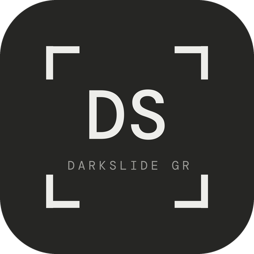
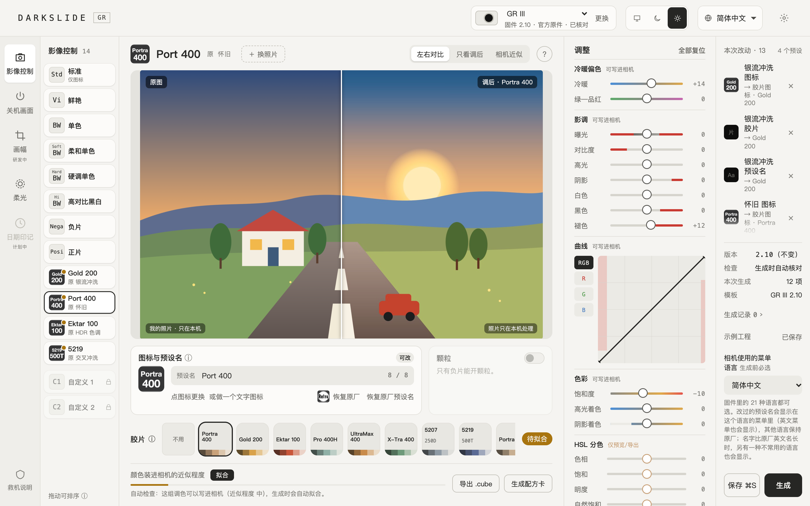
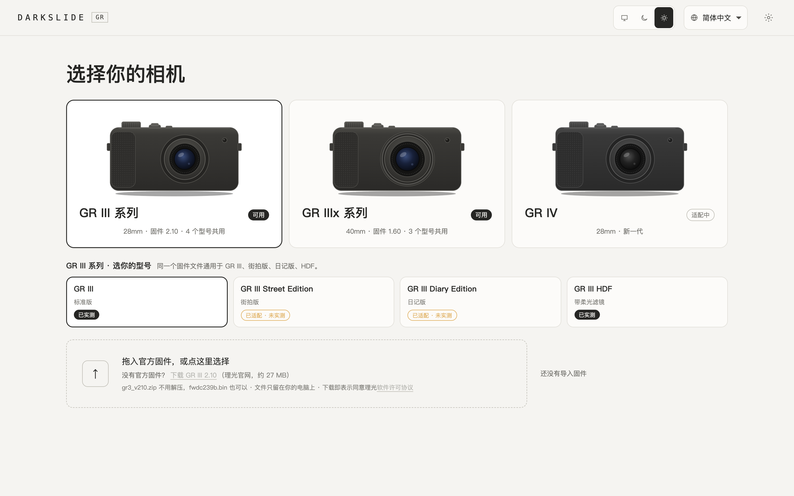
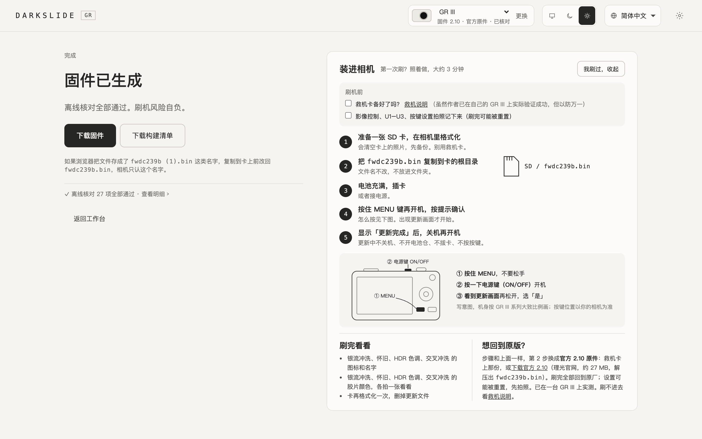
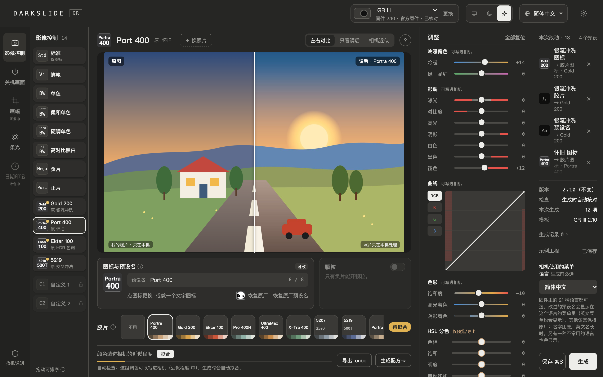

# DARKSLIDE GR

[简体中文](README.md) | English

Give your RICOH GR III / GR IIIx film colours, your own LUTs, your own preset icons and names, a reordered menu and soft glow. It all happens on your own computer and produces one firmware file you can flash to the camera.

> [!WARNING]
> Flashing modified firmware is risky: your camera may fail to boot or be permanently bricked, and you may lose your warranty. This project is not affiliated with RICOH. Read "Risks" below before you decide to flash.

## Download and install

### Desktop app (recommended)

Download the installer for your computer from [Releases](https://github.com/LiorMoment/darkslide-gr/releases/latest) and double-click to install. No Python, no terminal.

| Your computer | Download |
|---|---|
| Mac with Apple chip (M1, M2, M3, M4…) | `mac-apple-silicon.dmg` |
| Mac with Intel chip | `mac-intel.dmg` |
| Windows 10 / 11 (64-bit) | `windows-setup.exe` |

Not sure which Mac you have? Apple menu → About This Mac: "Chip Apple M…" means Apple chip, "Processor Intel…" means Intel.

**The system stops it the first time**, because the installers are not signed by Apple or Microsoft:

- **Mac**: close the warning, open System Settings › Privacy & Security and click "Open Anyway" near the bottom.
- **Windows**: when "Windows protected your PC" appears, click "More info › Run anyway". The Windows app has only been tested automatically on GitHub's machines; Windows 10 needs WebView2 (Windows 11 has it).

The desktop app is made by [@Ady0402](https://github.com/Ady0402).

### Script version

If you already have Python 3.9 or newer, you can run the source code directly: download it, then run `sh start.sh` on a Mac or double-click `start.cmd` on Windows. Your browser opens the page.

Both versions do the same and share one data folder, so you can use both. Everything runs on your computer; nothing is uploaded.

## What it does

- **Film colours**: put one roll of film on each of five presets (Vivid, Bleach Bypass, Retro, HDR Tone, Cross Processing). 16 built-in films, fine-tuned with sliders.
- **Your own LUT**: put a .cube you use in Lightroom, DaVinci Resolve or a phone app (or a Lightroom .xmp) into the camera, so the shutter gives you that colour. What the camera stores is an approximation, and the page shows how close it is; the first time needs a component of about 12 MB.
- **Icons and preset names**: give 12 presets your own icon (upload a picture or type a few letters) and name, shown in the camera menu.
- **Shutdown screen**: use your own picture.
- **Negative Film grain**: turn on the grain option of Negative Film; set its level in the camera.
- **Menu order**: drag to set the order of the Image Control menu; the movie and RAW development lists follow.
- **Soft glow**: the camera gets a "Soft glow" setting (off, weak, medium, strong) that makes bright areas bloom as if through a diffusion filter, shared by all presets.
- **Dark and light**: switch between match system, dark and light at the top right (from 1.6).
- **5 interface languages**: 简体中文, 繁體中文, English, 日本語, 한국어.

You can change all of these together and build once. Everything else stays factory; the firmware version stays the same and the firmware does not grow.

How each feature works and what to watch out for: [user guide](docs/user-guide/).

The fifth slot, Vivid, is available on GR III 2.10 / 2.20 and GR IIIx 1.60 / 1.70. Positive Film and Negative Film remain unchanged; only selected slots are replaced. One test build with five films, wide ratios and soft glow was tested on one standard GR III running 2.10 and flashed back to official firmware once. The user reported normal ratio switching and shooting, soft-glow shooting, and fifth-slot ordering and shooting. Item-by-item testing is incomplete; other bodies, versions and configurations still need camera testing.

**Wide ratios**: adds 16:9 and 65:24. Only the JPEG is cropped; RAW stays full 3:2. Available on GR III 2.10 (incl. Street, Diary) and GR IIIx 1.60 (incl. Urban); not on 2.20 / 1.70 or HDF bodies. It changes a few places on the MENU-held startup path.

## Supported cameras and testing

| Camera | Official firmware needed | Tested |
|---|---|---|
| GR III | 2.10 | ✅ Tested on one camera: earlier icons, preset names, shutdown screen, Negative Film grain and four films; basic use and one flash-back of one five-film, wide-ratio and soft-glow test build. Item-by-item testing and other configurations and states remain unverified |
| GR III HDF | 2.10 | ✅ Films, preset names and Traditional Chinese menus tested by a user; menu order and soft glow not tested |
| GR III Street, Diary | 2.10 | ⚠️ Adapted, not camera-tested |
| GR IIIx | 1.60 | ✅ Flashed and used by a user; menu order and soft glow not tested |
| GR IIIx Urban, HDF | 1.60 | ⚠️ Adapted, not camera-tested |
| GR III, all models (incl. Street, Diary, HDF) | 2.20 | ⚠️ Adapted, not camera-tested: the same features as 2.10 (no wide ratios yet), offline checks pass, the five films' data had an independent read-back after a full build, not yet flashed onto any camera |
| GR IIIx, all models (incl. Urban, HDF) | 1.70 | ⚠️ Adapted, not camera-tested: the same features as 1.60 (no wide ratios yet), offline checks pass, the five films' data had an independent read-back after a full build, not yet flashed onto any camera |
| GR IV | — | 🚧 Being adapted, cannot build yet |

- "Tested" means one camera; the samples are few, and your icons, names and film choices may not have been tried.
- Whenever you use something not camera-tested, you confirm the risk before every build.
- **Import the official file for the version your camera runs now** (Menu › Setup › Firmware version). 2.20 / 1.70 is new firmware released by Ricoh on 2026-10-21 with a recompiled main program; DARKSLIDE GR relocated every address it uses. Ricoh says the shutdown screen cannot be changed back after updating to 2.20 / 1.70; on the new firmware DARKSLIDE GR's shutdown image covers all seven shutdown styles, including the new 20th and 30th anniversary ones.
- Item-by-item testing notes: [user guide](docs/user-guide/).

## Risks

- After flashing, your camera may fail to boot or work properly, or be **permanently bricked**; you may also lose warranty and official support. The author accepts no liability for any loss.
- The checks before building run offline on your computer and cannot replace testing on a real camera.
- DARKSLIDE GR only produces a firmware file: it **does not talk to your camera or touch your memory card**. Whether and how to flash is entirely up to you.
- Before flashing, prepare a rescue card that holds only the official firmware (the app has a rescue guide).
- This project is not affiliated with or endorsed by RICOH.

If it breaks, you get to keep both pieces. If you cannot accept your camera becoming a very elegant brick, do not flash it.

## Official firmware you need

This repository contains **no** RICOH firmware and offers none for download. Download the official firmware from RICOH's website; it is checked when you import it.

| Camera | File name | Size | SHA-256 |
|---|---|---|---|
| GR III series · 2.10 | `fwdc239b.bin` | 30,391,780 bytes | `d6a3c9c288d784080e7b283222ecdd8752adfeed6faa36dab44f73115354bfd4` |
| GR IIIx series · 1.60 | `fwdc243b.bin` | 30,391,788 bytes | `708e79f3b7b96a7e1581b4acf4c412233050a1832718ef7f06c8397db1b431c7` |
| GR III series · 2.20 | `fwdc239b.bin` | 30,472,516 bytes | `5c53760b3b564c87239dbf7f5c94d0f6fd91accd156ec4ba672ebfd6b861793e` |
| GR IIIx series · 1.70 | `fwdc243b.bin` | 30,472,528 bytes | `aa8e3ae1349d94e83be381c20530e41d5e57b75c27ef24ba81c7b017d6c11592` |

Check it yourself: `shasum -a 256 fwdc239b.bin` (Windows: `certutil -hashfile fwdc239b.bin SHA256`). The same file is used by regular and HDF cameras, so pick the right model when you create a project.

## How it keeps you safe

- Only the official files in the table above are accepted; anything else is refused.
- Every build starts again from the official file, then a separate, independent piece of code unpacks and checks it. **Only if every check passes** is it offered for download, with a manifest of what changed.
- The version fields, boot records and registered hard-protection windows are preserved to help retain the ability to flash back; films, the fifth slot, Soft Glow and wide ratios all change code that may run when starting with MENU held, and existing checks cannot prove this never affects updates. One five-slot, wide-ratio and soft-glow test build was flashed back once on one standard GR III. Other configurations and states may behave differently; this is not a guarantee, and a camera that cannot boot at all is not covered.

## Screens

| Choose camera, import firmware | Build and verify |
|---|---|
|  |  |

Dark theme:

## Reporting issues

Use the "Bug report" form under [Issues](../../issues). Include camera model, firmware version, file SHA-256 and steps to reproduce. **Please never upload firmware files.** The SHA-256 is enough.

## License

[GPL-2.0-only](LICENSE). The author asks that it be used only for personal learning, sharing and research, and not for commercial purposes such as selling it or charging for flashing (this request is not an additional license condition).

More: [author statement](AUTHOR_STATEMENT.md) · [third-party notices](THIRD_PARTY_NOTICES.md) (in Chinese) · [changelog](CHANGELOG.md) · [developer notes](docs/developer-notes/)
