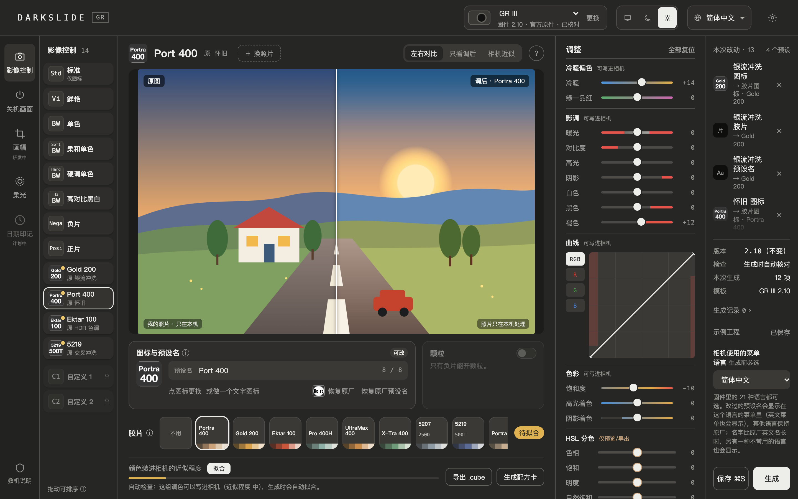

# DARKSLIDE GR

简体中文 | [English](README.en.md)

给理光 GR III / GR IIIx 换上胶片颜色、你自己的 LUT、自己的预设图标和名字，还能重排菜单、加上柔光。在你自己的电脑上完成，生成一个可以刷进相机的固件文件。

> [!WARNING]
> 刷入修改版固件有风险：相机可能无法开机，甚至永久变砖，也可能失去保修。本项目与理光（RICOH）无关。请先读完下面的「风险提示」再决定要不要刷。

## 下载与安装

### 桌面版（推荐）

到 [Releases](https://github.com/LiorMoment/darkslide-gr/releases/latest) 下载对应的安装包，双击安装即可，不需要装 Python，也不用开终端。

| 你的电脑 | 下载 |
|---|---|
| Mac（Apple 芯片：M1、M2、M3、M4…） | `mac-apple-silicon.dmg` |
| Mac（Intel 芯片） | `mac-intel.dmg` |
| Windows 10 / 11（64 位） | `windows-setup.exe` |

不知道是哪种 Mac？点左上角苹果图标 →「关于本机」：写着「芯片 Apple M…」就是 Apple 芯片，写着「处理器 Intel…」就是 Intel。

**第一次打开会被系统拦住**，因为安装包没有苹果和微软的开发者签名：

- **Mac**：关掉提示，打开「系统设置 › 隐私与安全性」，在下方点「仍要打开」。
- **Windows**：出现「Windows 已保护你的电脑」时，点「更多信息 › 仍要运行」。Windows 版只在 GitHub 的测试电脑上自动测过；Windows 10 需要已安装 WebView2（Windows 11 自带）。

桌面版由 [@Ady0402](https://github.com/Ady0402) 制作。

### 脚本版

已经装了 Python 3.9 或更新版本的话，也可以直接运行源代码：下载源代码后，Mac 运行 `sh start.sh`，Windows 双击 `start.cmd`，浏览器会自动打开页面。

两个版本功能相同，数据也放在同一个文件夹，可以混着用。所有处理都在你的电脑上完成，不会上传任何文件。

## 能做什么

- **胶片颜色**：给银流冲洗、怀旧、HDR 色调、交叉冲洗这 4 个预设，各装一卷胶片。内置 16 卷，可以再用滑块微调。
- **你自己的 LUT**：把 Lightroom、达芬奇或手机 App 里常用的 .cube（或 Lightroom 的 .xmp）装进相机，按下快门就是这个颜色。写进相机是近似效果，页面会显示近似程度；第一次使用要下载一个约 12 MB 的组件。
- **图标和预设名**：给 12 个预设换上自己的图标（上传图片或输入几个字母）和名字，相机菜单里就这样显示。
- **关机画面**：换成你自己的照片。
- **负片颗粒**：打开负片的颗粒选项，档位在相机里调。
- **菜单排序**：拖动排好影像控制菜单的顺序，视频和 RAW 显影里的列表跟着变。
- **柔光**：相机里多出「柔光」，可以选关、弱、中、强，让亮处像加了柔光镜一样晕开，所有预设共用。
- **深色和淡色**：右上角切换「跟随系统 / 深色 / 淡色」（1.6 起）。
- **5 种界面语言**：简体中文、繁體中文、English、日本語、한국어。

以上可以一起改、一次生成。不改动的部分保持原厂；固件版本号不变，固件不会变大。

每项功能的详细用法和需要注意的地方，见 [使用说明](docs/使用说明/)。

## 支持的相机和实测情况

| 相机 | 需要的官方固件 | 实测情况 |
|---|---|---|
| GR III | 2.10 | ✅ 作者在一台机身上实测：图标、预设名、关机画面、负片颗粒、刷回官方固件；四卷胶片、菜单排序、柔光也一起刷入测过，逐项记录待补 |
| GR III HDF | 2.10 | ✅ 胶片、预设名、繁体菜单已由用户实测；菜单排序、柔光未实测 |
| GR III 街拍版、日记版 | 2.10 | ⚠️ 已适配 · 未实测 |
| GR IIIx | 1.60 | ✅ 已由用户刷入使用；菜单排序、柔光未实测 |
| GR IIIx 城市版、HDF | 1.60 | ⚠️ 已适配 · 未实测 |
| GR IV | — | 🚧 适配中，暂不能生成 |

- 「实测」指在一台机身上测过，样本很少；你填的图标、名字和你选的胶片组合不一定测过。
- 用到「未实测」的部分时，生成前每次都要勾选确认风险自负。
- 逐项的实测说明见 [使用说明](docs/使用说明/)。

## 风险提示

- 刷入后相机可能无法开机或无法正常工作，甚至**永久变砖**；也可能因此失去保修和官方支持。作者不对任何损失负责。
- 生成前的检查都在电脑上离线完成，不能代替真机测试。
- DARKSLIDE GR 只生成一个固件文件，**不连接相机，也不碰存储卡**。要不要刷、怎么刷，完全由你决定。
- 刷之前，请准备一张只放官方原版固件的救机卡（软件里有救机说明）。
- 本项目与理光（RICOH）没有任何关联，也未获得其认可。

弄坏了，碎片归你。如果接受不了相机变成一块精致的砖，请不要刷入。

## 需要准备的官方固件

本仓库**不包含**任何理光固件，也不提供下载。请到理光官网下载官方原版，导入时会自动核对。

| 相机 | 文件名 | 大小 | SHA-256 |
|---|---|---|---|
| GR III 系列 · 2.10 | `fwdc239b.bin` | 30,391,780 字节 | `d6a3c9c288d784080e7b283222ecdd8752adfeed6faa36dab44f73115354bfd4` |
| GR IIIx 系列 · 1.60 | `fwdc243b.bin` | 30,391,788 字节 | `708e79f3b7b96a7e1581b4acf4c412233050a1832718ef7f06c8397db1b431c7` |

自己核对：`shasum -a 256 fwdc239b.bin`（Windows：`certutil -hashfile fwdc239b.bin SHA256`）。同一份固件区分不出普通版和 HDF，创建工程时请自己选对机型。

## 怎么保证安全

- 只接受上表里的官方原件，别的文件一律拒绝。
- 每次都从官方原件重新生成，生成后再用另一套独立的代码拆开核对，**全部通过才提供下载**，并附一份构建清单，写明改了什么。
- 版本号、开机引导和刷机更新区域一个字节都不改，让刷完之后仍能用官方原件刷回去。刷回已在一台 GR III 上实测成功，但这不是保证，完全开不了机的情况不在覆盖范围内。

## 界面

| 选择相机、导入固件 | 生成并核对 |
|---|---|
|  |  |

深色界面：

## 反馈问题

请在 [Issues](../../issues) 用「问题反馈」表单提交，写清机型、固件版本、文件 SHA-256 和操作步骤。**请不要上传任何固件文件**，提供 SHA-256 就够了。

## 许可

本项目采用 [GPL-2.0-only](LICENSE)。作者倡议仅用于个人学习、交流和研究，请勿用于销售、收费刷机等商业用途（倡议不是许可的附加条件）。

更多：[作者声明](AUTHOR_STATEMENT.md) · [第三方材料说明](THIRD_PARTY_NOTICES.md) · [更新记录](CHANGELOG.md) · [开发者说明](docs/开发者说明/)
